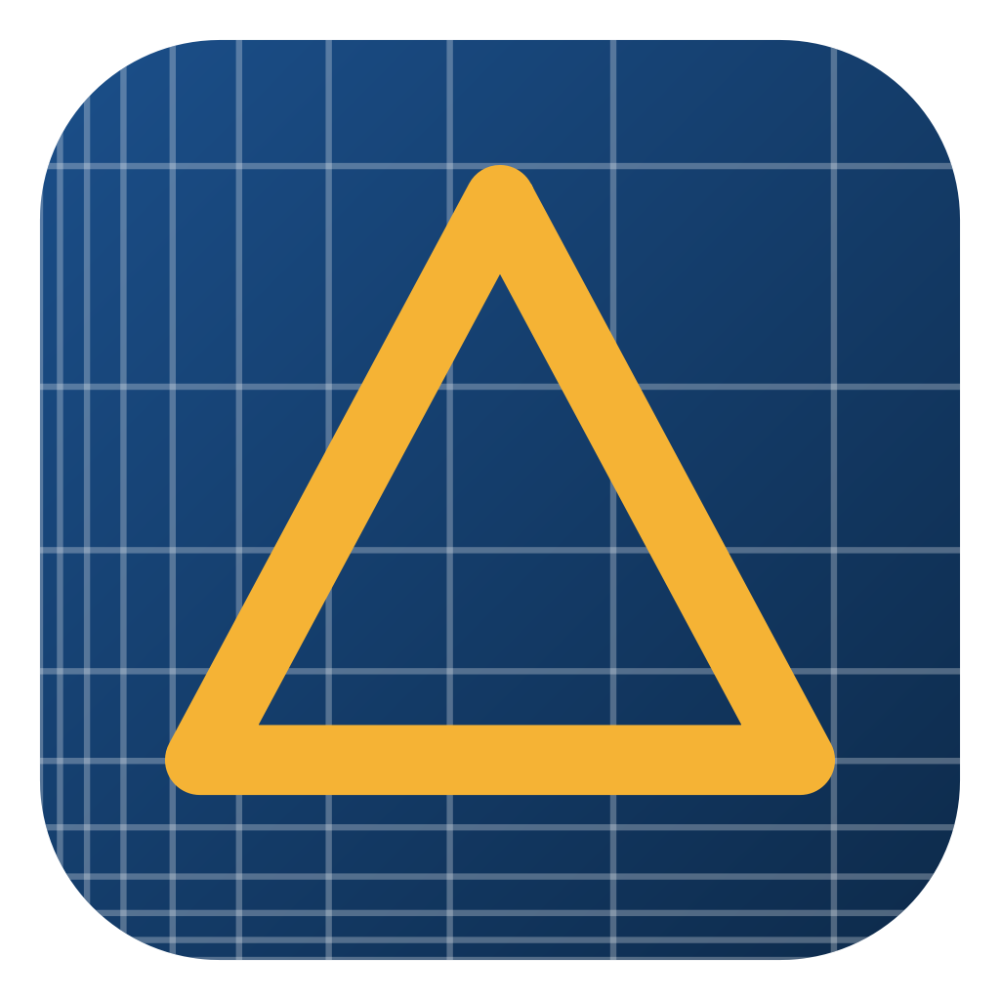
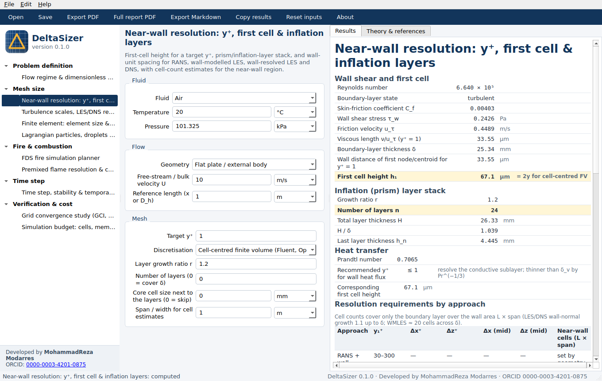

# DeltaSizer

**Mesh, cell-size and time-step planner for CFD, FDS and finite-element simulations.**

DeltaSizer answers the questions every simulation starts with: how fine must the mesh be, how small the time step,
how many cells, how much memory, how long will it run — and why. Each result comes with the equations, assumptions
and literature behind it, and can be exported as a PDF report.

## Calculators

| Area | What you get |
|---|---|
| Flow regime | Re, Ma, Gr, Ra, Ri, Fr, Pe; laminar/turbulent, compressibility, buoyancy; time scales; modelling advice |
| Near-wall resolution | First-cell height for a target y⁺, inflation layers, spacing and near-wall cell counts for RANS, WMLES, WRLES, DNS |
| Turbulence scales | RANS inlet k, ε, ω, ν_t; Kolmogorov and Taylor scales; LES filter width; DNS cell size and counts |
| Finite element | Element size and time step for transient heat conduction and structural dynamics; DOF estimates |
| Particles | Relaxation time, Stokes number, terminal velocity, point-particle validity, particle time step |
| FDS fire | D*, D*/δx, flame height, plume velocity, FFT-friendly cell counts, MPI meshes, time step, run time, memory |
| Premixed combustion | Flame thickness, cells across the flame, LES thickening factor, Da, Ka, combustion regime |
| Time step | Convective, acoustic and diffusive limits; frequency resolution; points per wavelength; run length |
| Grid convergence | Observed order, Richardson extrapolation, GCI (Celik et al., 2008) |
| Simulation budget | Cells, memory, core-hours, wall-clock time, cells per core, output storage |

## Download

Get the latest installers from **[Releases](../../releases)**:

- **Windows 10/11 (64-bit):** `DeltaSizer-x.y.z-Windows-x64.zip` — unzip anywhere and run `DeltaSizer.exe`
  (no installation needed). If SmartScreen appears, choose *More info → Run anyway*.
- **macOS (Apple Silicon or Intel):** `DeltaSizer-x.y.z-macOS-arm64.dmg` or `-x86_64.dmg` — open, drag DeltaSizer to
  Applications. The first time, right-click the app and choose *Open*.

Verify downloads with `SHA256SUMS.txt`. The user and theory manual is attached to every release.

## Cite

See `CITATION.cff` or *Help → How to cite* in the program. A DOI is provided on Zenodo.

## Licence

Free to use, including commercially (see `LICENSE.txt`). Results are planning estimates; always confirm with grid and
time-step sensitivity studies.

© 2026 MohammadReza Modarres
